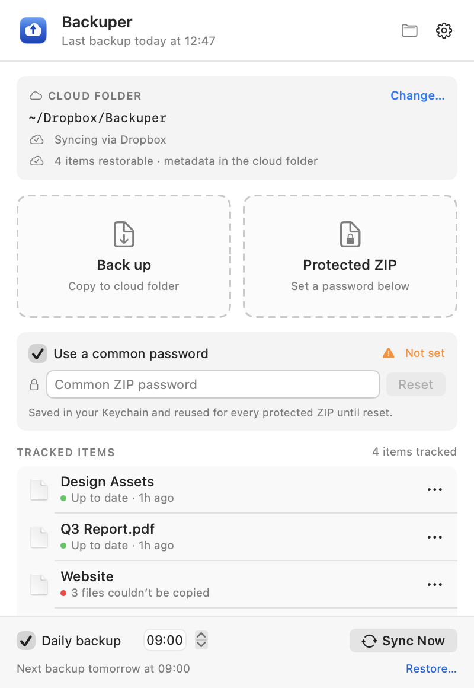
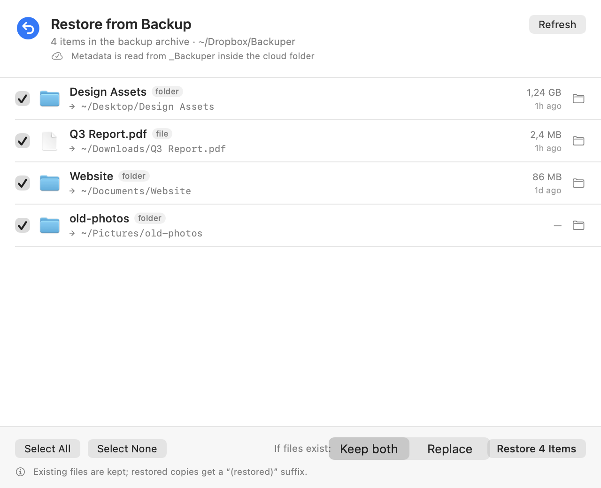

# Backuper

[](https://github.com/butelo/backuper/actions/workflows/ci.yml)
[](https://github.com/butelo/backuper/releases/latest)
[](LICENSE)

A small native macOS menu-bar app that keeps copies of chosen files and folders in
a cloud-synced folder — **OneDrive, Dropbox, Google Drive, iCloud Drive, Box,
pCloud, MEGA, Sync.com, Tresorit, Nextcloud, ownCloud, or any folder your own sync
client manages** — re-checks them daily, and can restore them to their original
paths, even on a different Mac.



## Why

Cloud clients sync a folder, not arbitrary files scattered around your disk.
Backuper gives you a simple drop target: drop files or folders, they land in your
cloud folder, and the client uploads them. It also keeps portable metadata so the
copies can be found and restored later.

## Features

- Menu-bar app (no Dock icon). Click the cloud icon to open a small drop window.
- Drag and drop files or folders; they are copied into the chosen cloud folder
  immediately.
- A second drop target creates a **password-protected ZIP** of the dropped files
  instead, for contents you do not want sitting readable in the cloud.
- Re-checks tracked items every day at a time you choose; new and changed files
  are copied, unchanged files are skipped.
- Never modifies or deletes the originals. It copies.
- Writes metadata **inside the cloud folder** (`_Backuper/`), so a fresh Mac can
  restore from the cloud alone:
  - `manifest.json` — the index;
  - `records/<uuid>.json` — one record per item, used to rebuild the index;
  - `RECOVERY.md` — human-readable original paths for manual recovery.
- Restore window with **Keep both** (default, never overwrites) or **Replace**
  (moves the old file aside first, so a failed copy cannot destroy it).
- On first launch it auto-detects cloud folders and can pick up an existing
  archive already synced there.
- Universal binary (Apple Silicon + Intel), macOS 13+.

## Supported cloud folders

Backuper looks for these locations automatically:

| Provider | Detected location |
| --- | --- |
| OneDrive | `~/Library/CloudStorage/OneDrive-*`, `~/OneDrive*` |
| Dropbox | `~/Dropbox`, `~/Library/CloudStorage/Dropbox*` |
| Google Drive | `~/Google Drive`, `~/Library/CloudStorage/GoogleDrive-*` |
| iCloud Drive | `~/Library/Mobile Documents/com~apple~CloudDocs` |
| Box | `~/Box`, `~/Library/CloudStorage/Box*` |
| pCloud | `~/pCloudDrive` |
| MEGA | `~/MEGA` |
| Sync.com | `~/Sync` |
| Tresorit / Nextcloud / ownCloud | matching folders |

Any other folder can be selected with **Change…**. The app only checks that the
folder looks like a known cloud-sync location and warns otherwise; it does not
block you. The actual upload is always done by your provider's client.

## Install

1. Download `Backuper.zip` from [Releases](https://github.com/butelo/backuper/releases/latest).
2. Unzip it and move `Backuper.app` into `/Applications`.
3. First launch only: right-click `Backuper.app` → **Open** → **Open**. The app is
   ad-hoc signed but not notarized, so Gatekeeper asks once. If macOS says the app
   is damaged, run:

   ```bash
   xattr -dr com.apple.quarantine /Applications/Backuper.app
   ```

4. A cloud icon appears in the menu bar. If you have many menu-bar items, it may
   be behind the menu-bar chevron.

## First run

1. Click the cloud icon.
2. Backuper proposes `<detected cloud folder>/Backuper` (for example
   `~/Dropbox/Backuper` or `~/Library/CloudStorage/OneDrive-Personal/Backuper`).
   Use **Change…** to choose another folder — inside the same cloud or any other
   synced folder.
3. Drag files or folders from Finder into the window. They are copied into that
   folder right away; your cloud client uploads them.

The window shows the provider it detected (for example **Syncing via Dropbox**)
or an orange warning when the folder is outside the usual cloud locations.

## Daily backups

- Leave **Daily backup** on and pick a time.
- The app must be running for the timer to fire. Turn on **gear menu → Launch at
  Login** so it starts with the Mac.
- If the Mac was asleep or the app was closed at the scheduled time, Backuper
  catches up once on the next launch or wake.
- **Sync Now** runs a check immediately.

## Password-protected ZIP backups

The right-hand drop target (**Protected ZIP**) behaves differently from the normal
one: instead of copying the files as they are, it writes one encrypted `.zip`
snapshot to `<cloud folder>/Protected Zips/`. This is useful when the cloud
provider (or anyone with access to the synced folder) should not be able to read
the contents.

- **Use a common password** (checked by default) reuses one password for every
  protected ZIP. Uncheck it to keep a separate, specific password for these
  archives instead. Each mode remembers its own password.
- The password field **holds** its value: it survives closing the window, using
  the drop target, and restarting the app. Press **Reset** to forget the active
  password.
- Changing or resetting a password only affects **new** ZIPs. Existing archives
  keep the password they were created with; Backuper does not re-encrypt them,
  so keep the old password if you still need those files.
- Passwords are stored in the macOS **Keychain**, not in `config.json` or the
  cloud folder. The checkbox choice itself is stored in the local config.
- Zips are snapshots taken at drop time. They are not re-created by the daily
  check; drop the item again to make a fresh snapshot. Existing zips are never
  overwritten — a ` 2`, ` 3`… suffix is added.
- Files larger than 64 MB are stored without compression; smaller files are
  deflated when that makes them smaller. Symlinks are followed, empty folders are
  preserved, and the usual junk files (`.DS_Store`, Office lock files,
  `_Backuper`) are skipped.
- Archives keep the dropped name (`Project Alpha.zip`), or use a timestamped
  `Protected Backup <date>.zip` name when several items are dropped together.

> **Security note:** For compatibility with macOS's built-in Archive Utility and
> `unzip`, Backuper writes the legacy ZIP 2.0 (ZipCrypto) password scheme. It keeps
> casual snooping out but is not modern encryption. Use a long,
> unique passphrase, and use 7-Zip/Keka (AES-256) instead if you need strong
> protection. Prefer ASCII characters in ZIP passwords: tools differ in how they
> encode accented letters, so the same-looking password may not always open the
> same archive elsewhere. Standard ZIP also leaves file names visible; only the
> file contents are encrypted.

## Metadata and restore

Everything needed to restore lives inside the cloud folder, so it is uploaded by
your provider along with the backups:

```text
<cloud folder>/
├── Project Alpha/            ← backed-up items
├── report.pdf
├── Protected Zips/           ← encrypted ZIP snapshots
│   └── Project Alpha.zip
└── _Backuper/
    ├── manifest.json         ← portable index (do not edit)
    ├── records/<uuid>.json   ← one metadata file per item
    ├── RECOVERY.md           ← human-readable original paths
    └── README.txt
```

For each item the metadata records:

| Field | Meaning |
| --- | --- |
| `relativePath` | where the copy lives under the cloud folder |
| `originalPath` | full path on the Mac it came from |
| `originalPathFromHome` | same path relative to `~` (works when the user name differs) |
| `isDirectory` | file or folder |
| `addedAt`, `lastSyncAt` | timestamps |
| `hostName`, `userName` | which Mac/user added it |
| `fileCount`, `byteCount` | size of the item |

Each copied file also gets extended attributes, visible with `xattr -l "file"`:
`com.backuper.original-path`, `com.backuper.item-id`,
`com.backuper.backed-up-at`. Cloud services may not preserve xattrs, so the
metadata files are the reliable source of truth.

### Restoring

Click **Restore…** in the window (or **gear menu → Restore from Backup…**).



- Pick the items, then **Restore N Items**.
- **Keep both** never overwrites: if something already exists at the original
  location, the restored copy gets a `(restored)` suffix.
- **Replace** puts the backup version back over the current file. The old file is
  moved aside first, so a failed copy cannot destroy it.
- Restoring does not delete the copies in the cloud folder.

### Restoring on a new Mac

1. Install Backuper there and let the cloud client finish setting up.
2. On first launch Backuper looks for an existing backup folder inside the
   detected cloud folders — `<cloud>/Backuper`, or any immediate subfolder
   containing `_Backuper/manifest.json` — and selects it automatically. Otherwise
   choose the folder with **Change…**.
3. Open **Restore…**. The list is read from the cloud folder, not from local app
   state. Opening a cloud-only placeholder triggers its download.

You can also restore manually using `_Backuper/RECOVERY.md`: it lists each item's
backup path and the original path to copy it back to.

## Good to know

- Backuper copies; it never moves or deletes the originals.
- A file is skipped when the cloud copy is identical (same size and modification
  date).
- If the cloud copy is **newer** than the original (for example it was edited in
  the cloud), Backuper leaves it alone rather than clobbering it.
- Deleting something from the source folder does **not** delete its backup copy.
  The item is marked “Original no longer exists” until you remove it.
- Renaming/moving an original is not followed; remove and re-add it.
- Name clashes in the cloud folder are avoided with ` (2)`, ` (3)`… Re-adding a
  previously tracked item reuses its existing backup folder.
- `.DS_Store`, `desktop.ini`, Office `~$` lock files and the `_Backuper` metadata
  folder are skipped. Symlinks are copied as symlinks; other hidden files are
  copied.
- Cloud “online-only” placeholders are downloaded automatically when Backuper
  reads a source or restore file.
- The daily run is a scheduled re-scan, not a filesystem watcher. Dropped items
  sync immediately; other edits wait for the next daily run or **Sync Now**.
- Protected ZIPs are one-off snapshots and are not part of the daily re-check.
  Their passwords live in the Keychain and are not written to `config.json`.

## Troubleshooting

- **No icon in the menu bar:** macOS may hide extra items behind the `«` chevron,
  especially on notched Macs. Quit some other menu-bar apps or click the chevron.
- **“This folder isn’t inside a known cloud-sync folder”:** the folder is outside
  the usual locations (custom OneDrive/Dropbox paths are allowed). It still works;
  make sure your client really syncs it.
- **Nothing uploads:** check that the provider's client is running and signed in,
  and that the folder is not paused. Backuper only writes to the local folder.
- **Permission prompts:** macOS may ask for access to Desktop, Documents or
  Downloads the first time Backuper reads from them. Allow it.
- **Log:** `~/Library/Application Support/Backuper/backuper.log`
- **Reset tracking:** quit Backuper and delete
  `~/Library/Application Support/Backuper/config.json`. The copies and
  `_Backuper/` metadata stay in the cloud folder and can still be restored.
  Protected ZIP passwords are separate Keychain items; use **Reset** in the
  window to remove them.
- **Launch at login:** if the toggle fails, make sure the app is in `/Applications`
  and approve it in **System Settings → General → Login Items**.
- **Keychain prompt:** ad-hoc signatures change with each build, so after
  replacing the app macOS may ask once for access to the saved ZIP password.
  Choose **Always Allow**.

## Build from source

Requirements: macOS 13+ and the Command Line Tools (`xcode-select --install`).
Full Xcode is not required.

```bash
git clone https://github.com/butelo/backuper.git
cd backuper
./Tests/run.sh     # 103 end-to-end checks
./build.sh         # build/Backuper.app + build/Backuper.zip (universal, ad-hoc signed)
open build/Backuper.app
```

- `./Tools/make_icon.sh` regenerates `Resources/AppIcon.icns` (needs only AppKit).
- `build/` is ignored by git.
- GitHub Actions runs the tests and build on every push (`.github/workflows/ci.yml`).
- The app is intentionally ad-hoc signed. Notarization would need an Apple
  Developer account; without it macOS asks for a one-time approval.

### Project layout

```text
Sources/
  main.swift             app entry point
  AppDelegate.swift      status item, popover, context menu, restore window
  AppState.swift         tracking, scheduling, drop handling, archive state
  PopoverView.swift      main window UI
  RestoreView.swift      restore window UI
  SyncEngine.swift       copy/compare logic + per-file metadata
  RestoreEngine.swift    restore logic (keep both / replace)
  Catalog.swift          _Backuper metadata read/write/rebuild
  Models.swift           TrackedItem, BackupRecord, configuration
  Storage.swift          config file, logging
  CloudFolderLocator.swift  finds OneDrive/Dropbox/Google Drive/iCloud/… folders
  ZipEngine.swift        encrypted ZIP writer (ZipCrypto + deflate + ZIP64)
  PasswordStore.swift    Keychain storage for ZIP passwords
  Xattr.swift            extended attributes
  Format.swift           formatting helpers
Tests/                   end-to-end tests (temp fake cloud folder)
Tools/                   icon generator
docs/                    screenshots
```

### Tests

`./Tests/run.sh` builds a test binary and runs it against a temporary folder under
`build/tests/`. It covers first backup, skipping unchanged files, updates, newer
cloud copies, missing sources, metadata, xattr, manifest rebuild from per-item
records, keep-both/replace restore, relocation to a “new Mac”, cloud-provider
detection, and encrypted ZIP creation (read back with both `unzip` and
`bsdtar`, wrong-password rejection, deflate, ZIP64, and naming). No real cloud
account or fixture files are needed.

## Limitations

- macOS 13+.
- The app must be running for scheduled backups; launch at login is recommended.
- Your cloud client must handle the actual upload. Backuper does not use provider
  APIs and cannot upload by itself.
- No version history beyond what the provider keeps; no pruning of deleted
  originals.
- Not notarized, so Gatekeeper needs a one-time approval.
- The metadata includes the original absolute path and host/user name. This is
  what makes restore work; it is stored in your own cloud folder, not sent
  anywhere else.
- Password-protected ZIPs use the legacy ZIP 2.0 (ZipCrypto) scheme for
  compatibility with macOS's built-in tools. It is not equivalent to AES-256.
- Protected ZIPs are snapshots; they are not recreated by the daily check and
  are not listed in the Restore window. Open `Protected Zips/` in the cloud
  folder (or use **Show last ZIP**) to get them.

## License

[MIT](LICENSE)
